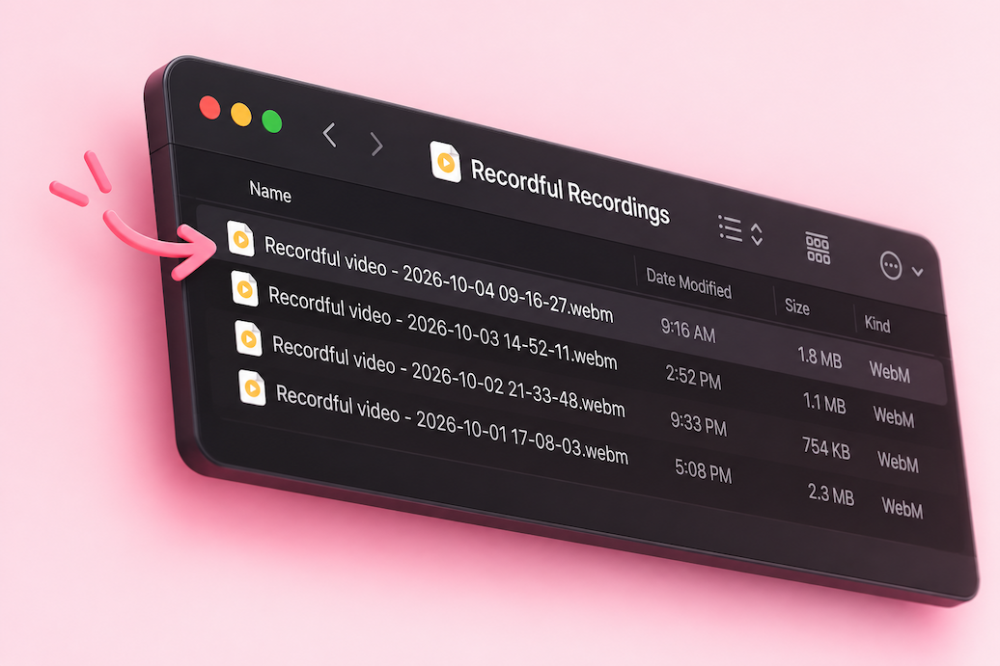

# Recordful

**Beautiful screen recordings, in minutes.**

Record your product in the browser, then turn it into a polished video
with smart zooms, cinematic camera movement, 3D effects, transitions, and
motion design. Professional screen recording, without the production
workflow.

> Recordful Pro ([recordful.app/pro](https://recordful.app/pro)) adds cloud
> sharing, multi-scene editing, auto-zoom keyframes, and captions for the
> solo developer behind this project.

## Features

- Unlimited recordings: tab, area, desktop, application window, or camera
- Microphone and system audio, with push-to-talk
- Live annotation: draw, text, arrows, shapes, spotlight, click highlight
- AI camera backgrounds and blur, sensitive-content blur
- Smooth zoom to focus on details while recording
- Built-in editor: trim, crop, and manage audio tracks
- Export to MP4, GIF, and WebM, or save to Google Drive
- Alarms, countdown, movable toolbar, fully offline-capable

## Private by default

Recordings stay on your device until you choose to export or upload them:



## Install

No Chrome Web Store listing yet. Until there is one, run the latest
release unpacked:

1. Download the newest `Build.zip` from the
   [releases page](https://github.com/iKislay/recordful/releases) and unzip it.
2. Open `chrome://extensions/` and enable developer mode.
3. Click **Load unpacked** and select the unzipped folder.

To enable Save to Google Drive, create your own OAuth client ID
([Google Cloud Console](https://console.cloud.google.com/apis/credentials)
> Create Credential > OAuth Client ID > Chrome App) and put it in
`manifest.json`. See [this guide](https://developer.chrome.com/docs/extensions/reference/manifest/key)
for a persistent extension key.

## Develop

Requires Node.js >= 14.

```bash
npm install
npm start        # watch mode, outputs to build/
```

Then load the `build` folder as an unpacked extension. `npm run build`
produces a one-off build.

Two release builds exist (both gated by secret-scan scripts):

| Command | Use |
|---|---|
| `npm run build:release` | Public zip, cloud features off |
| `npm run build:cws` | Chrome Web Store upload, backend URLs baked in |

## Self-hosting

Self-hosted (unpacked) builds run in local-only mode: no API calls, no
sign-in, no uploads. Cloud features only activate in the official store
build, which talks to the private backend over build-time env vars
(`RECORDFUL_API_BASE_URL`, `RECORDFUL_APP_BASE`, `RECORDFUL_WEBSITE_BASE`,
`RECORDFUL_ENABLE_CLOUD_FEATURES`).

Every build, self-hosted ones included, opens recordings in the web editor
at [recordful.app/editor](https://recordful.app/editor) (or
`RECORDFUL_APP_BASE` when set). The recording is passed from the extension
to the editor page inside your browser and is never uploaded. The editor
built into the extension is used only when the site can't be reached and
for recovering an interrupted recording. To always use the built-in editor
instead, build with `npm run build:builtin` or `RECORDFUL_EDITOR=builtin`.

## License

[GPLv3](https://github.com/iKislay/recordful/blob/master/LICENSE) for
version 3.0.0 and higher.

Made by [Kislay](https://github.com/iKislay)
